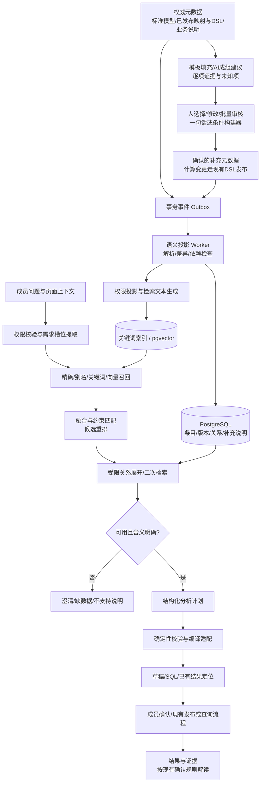

# AI 业务语义自动生产、检索与分析规划：完整设计及实施方案 v1.1

日期：2026-11-01（v1.1 同日修订）。状态：决定已经记录在 ADR 0046–0050，尚未实现。**本文和 ADR 冲突时，以 ADR 为准。**代码核对基线：提交 `83d5801`；代码符号和相对链接便于实施定位，后续以实际分支为准。

目标：复用现有语义目录、已发布 DSL、映射、权限与计算链路，建设可以自动更新、混合检索、二次排序、补充检索、校验分析计划的服务。第一期不引入独立图数据库，不迁移到 dbt，不开放平台内 AI 自动执行和发布。

阅读顺序：先看结论、需求、总体架构；再看数据设计、知识自动生产、增量更新、检索与分析计划；实施人员按“现有代码实施指南”和统一阶段计划推进。所有新表、接口、模块、UI和工时都是本方案建议，不代表当前项目已具备。代码事实、外部参考和项目设计判断分别标明；外部资料不能代替本项目的权限及计算契约。

## 0. v1.1 修订：已经确定的决定（以此为准）

v1.0 经过一轮设计评审，范围有所收缩，决定记录在 ADR 中。后文保留 v1.0 的分析（需求、变化处理矩阵、退款率案例、评测分层、模型选型原则），可供 `/prep-ticket` 写实现指南时参考；与下表冲突的段落以下表为准，凡是已被替换的段落都标了「v1.1」。

| 主题 | 决定 | ADR |
|---|---|---|
| 知识层 | 新增别名（不表示等价）、口径声明（首期五种，可为「未知」）、分析主题（多对多分类，只用来检索加权和区分口径）、知识提案；业务说明扩展到实体、指标、标签；人写的立即生效、记审计，AI 写的要成员接受才生效；**不新增 `semantic:draft` / `semantic:approve` 权限**，也不做双人审批；同一个「业务知识」面板，另加按主题的集中页 | 0046 |
| 持久投影 | 权威事实实时读；检索投影可以持久化，**按目录版本（`catalog_versions`）懒刷新，不建 `semantic_outbox`，不加 `semantic-worker` 进程，不维护索引代际**；可见性类别按 `catalogFor` 用到的权限位划分（目前两类）；embedding 按 `(租户, 模型, 文本哈希)` 缓存 | 0047 |
| 排序与歧义 | RRF 融合，别名命中优先；作用域（明确说的 > 页面 > 对话 > 空间）只加权、不排除；歧义由服务端发现，`catalog_search` 返回 `ambiguous` 与口径对比 | 0047 |
| 空间 | 「业务单元」就是现有的空间；`dsl_definitions` 加 `space_id`，只作记录、不隔离，完整的多空间另立项目 | 0048 |
| embedding | 在 `model_providers` 里可选配置，平台与租户两级，外发内容和 chat 相同，不另设外发政策 | 0049 |
| 分析计划 | 是对话里的产物，经 `validate_plan` 校验；**不建 `analysis_plans` 表，不做状态机，不用确认令牌**；五种模式、四类检查；执行前重新校验 | 0050 |
| 知识入口 | 六个都做，分三批：①⑥ → ④⑤ → ②③ | 0046 |
| 模型路由 | 第 18 节单独开票，不在本方案范围内 | — |
| 评测 | 黄金集首批 40 条，逐步扩到 100 条；确定性层（别名、加权、歧义、`validate_plan`）用 vitest 测、进 CI，模型层扩展 `eval:requirements`、不进 CI | 0047、0050 |

## 1. 结论与边界

采用“现有元数据为权威来源 + PostgreSQL 语义投影与关系 + 可选 pgvector + 确定性计划校验”。

- 业务含义参考 SKOS/ontology 的概念、别名和关系建模；计算语义参考 dbt 的键、维度、时间和聚合建模。内部 JSON 是项目自己的契约，不宣称兼容 OWL 或 dbt YAML。
- 已发布 DSL 是公式的唯一权威来源；不让模型重新翻译后保存另一份可执行公式。
- 索引是可重建的派生元数据，不存消费者实例、业务明细或查询结果。DuckLake 仍是业务数据的落点。
- AI 负责需求理解和提议；后端负责权限、版本、能力与计划合法性。相似度不是业务正确率。
- 所有阈值、候选数量、性能及质量目标都是首轮建议，必须由基线评测调整。
- DuckDB 2.0 升级作为独立项目实施，语义检索无需等待该升级。此文不承诺解决跨事实表比率、任意粒度指标或历史维度关联。
- 与[ADR-0004](adr/0004-own-dsl-and-templates-not-dbt.md)保持一致：只借鉴dbt的建模方法，不引入已被否决的每租户dbt项目或MetricFlow执行链。与[ADR-0041](adr/0041-semantic-catalog.md)的“实时生成、不存成文档”之间需要明确新增决策：允许保存可重建、有来源版本的检索投影，权威目录仍由当前元数据确定，索引不能成为第二份事实。

## 2. 已有基础与真实缺口

| 现有模块 | 已有能力 | 本次改造 |
|---|---|---|
| `app/.server/catalog/index.ts` | 实体、字段、关系、指标、标签、模板、统计、搜索与渲染 | 保持纯函数；增加业务概念、计算契约和检索摘要 |
| `catalog/load.ts` | 从已发布定义、映射及元数据生成目录 | 增加一致性读取与投影生成入口 |
| `catalog/versions.ts` | 目录版本、变更记录，统计不计结构版本 | 复用变更语义，增加条目摘要与索引代际 |
| `assistant/tools.ts` | 总览、搜索、展开、校验、草稿工具；按角色裁剪目录 | 接入检索服务，统一所有文本/向量/边的访问投影 |
| `pipeline/dsl/model-draft.ts` | 关键词相关条目，最多15项及约6000 token预算 | 用需求槽位、混合检索和校验后的上下文替换简单匹配 |
| `workbench-ai.ts` | 表目录截取、SQL起草校验、确认后解读 | 改用工作台可读对象专用的受控检索适配器 |
| `dsl-definitions.ts` | 定义校验、双人发布、预览、重算和回刷 | 复用其接口，不另建计算引擎 |
| `pipeline/dispatcher.ts` | 持久任务调度，采集/同步后比较目录 | 触发语义事件；元数据索引工作由独立PG worker处理 |
| `background.ts` | 进程内后台函数，退出可能丢失 | 不用于索引可靠投递 |

当前检索按英文词/中文二元组命中数排序，缺少别名优先、需求约束匹配和依赖补齐。单次标签 AI 起草使用单指标 Schema，而底层 DSL 支持更多组合：需要专门评测和对齐，不应以检索改造代替能力适配。

## 3. 用户需求与验收行为

| 编号 | 用户场景 | 必须产生的行为 |
|---|---|---|
| R1 | 用别名、口语查询指标 | 返回候选摘要、命中理由及口径，不要求知道字段名 |
| R2 | 同名或近义指标有多个口径 | 展示分子/分母、窗口、粒度、时间和单位差异；必要时询问 |
| R3 | 请求维度或数据范围未提供 | 二次检索并检查关系；不能只因关键词接近选用 |
| R4 | 已有指标完全适合 | 优先复用，不另造同义定义；核对快照参数及新鲜度 |
| R5 | 只有近似指标 | 清楚区分“可起草新定义”和“现有指标可直接回答” |
| R6 | 新源表、新字段、新指标 | 自动加入对应目录；未映射字段不冒充可计算标准字段 |
| R7 | 删除字段、停用映射、修改公式 | 识别受影响绑定/计划；失效内容不能执行 |
| R8 | 普通新增数据 | 更新运行状态/统计，不重建所有概念和向量 |
| R9 | 不同角色、租户提相同问题 | 返回各自可见内容；不得在摘要、分数解释、向量或缓存泄露 |
| R10 | 平台无法表达需求 | 返回具体限制及可行下一步，不宣称已执行 |
| R11 | 成员确认查询并请求解读 | 延续现有查询授权与外发确认；保留样本、截断和覆盖范围说明 |
| R12 | 不想逐字段写说明 | 自动派生公式/依赖，成组给出带依据的建议；人只处理未确定项 |
| R13 | 用一句话或选择题创建业务条件 | 生成同一DSL草稿、展示解析差异和未知项，继续原校验发布 |
| R14 | 多个字段共享同一约定 | 有作用域的继承和批量确认，例外单独保留，源单位与标准单位分开 |
| R15 | 回答过的歧义不想反复回答 | 可明确提交为待审核约定；单次答案不自动变全租户默认 |

## 4. 总体架构



关键词服务、图展开和计划校验都是应用模块，不是额外中间件。新增基础设施仅为平台PG可用的pgvector及embedding端点；未配置时关键词链路必须仍可工作。现有聊天端点未必支持embedding，须独立探测/配置，不默认同模型兼容。

## 5. 数据设计：什么保存，什么派生

### 5.1 权威来源与人工补充

自动事实来自 canonical-model、注册实体、已发布映射、DSL AST、模板注册表及算子注册表。业务说明是元数据；敏感值与明细不能混入。无法验证的币种、含税、退款扣减、业务别名等不得因AI高置信度自动确认为事实。

已确认别名也不表示严格逻辑等价。比如“消费金额”和“净消费金额”不可默认互换。每条补充绑定来源摘要和证据；公式变化后对可能冲突的说明重新确认。

### 5.2 建议表

所有表放在平台元数据库。以下是逻辑结构，实际迁移采用Drizzle、复合外键和约束。`tenant_id`参与每个主键/关联条件，稳定ID不得跨租户解析。

（v1.1）下表替换 v1.0 的九张表。按阶段创建，具体字段由各票的实现指南定。

| 表 | 主要字段 | 作用 | 性质 |
|---|---|---|---|
| 业务说明（扩展现有表） | 目标改为通用的目录条目标识（实体、字段、映射字段、指标、标签） | 自由文本说明 | 权威知识 |
| 别名 | tenant_id, target_id, alias, author, created_at, retired_at, needs_review | 检索用词 | 权威知识 |
| 口径声明 | tenant_id, target_id, claim_type, value（含 unknown）, based_on_hash, needs_review, author | 结构化口径 | 权威知识 |
| 分析主题、主题归属 | tenant_id, subject_id, name；tenant_id, subject_id, target_id | 多对多分类 | 权威知识 |
| 知识提案 | tenant_id, proposal_id, target_id, claim, evidence, based_on, fingerprint, status, reviewer, rejected_reason, generator_version | AI 生成、等成员确认 | 权威知识 |
| 检索投影 | tenant_id, visibility_class, entry_id, text, text_hash, subjects, space_id, aliases, catalog_version | 按目录版本懒刷新，可以从头重建 | 派生 |
| 向量缓存 | tenant_id, model_id, text_hash, dimension, vector | 按内容寻址，丢了可以重算 | 缓存 |

不建：`semantic_outbox`、`semantic_index_state`、`semantic_entry_versions`、`analysis_plans`（ADR-0047、ADR-0050）。

表结构不意味着必须首个PR一次创建全部表；按阶段启用。第一期历史可只保留审查所需版本，计划引用的历史不可提前清理。已有草稿与审计不重复存全文。

索引：(tenant_id, kind, lifecycle)、(tenant_id, entry_id)、正向/反向边索引、名称/已确认别名索引；中文关键词沿用二元组预处理并评测，不假定Postgres默认英文分词适合中文。pgvector维度及索引操作符与选定embedding模型一致；不同维度使用独立索引/表，不混算。

### 5.3 指标条目示例（内部JSON契约）

```json
{
  "id": "metric:paid_spend_30d",
  "kind": "metric",
  "name": "近30天已支付消费金额",
  "source": {"kind": "dsl", "key": "paid_spend_30d", "version": 3},
  "semantics": {
    "base": "order",
    "measure": {"agg": "sum", "field": "amount"},
    "filter": [{"field": "status", "op": "eq", "value": "paid"}],
    "window": {"field": "paid_at", "days": 30},
    "outputGrain": ["consumer_id"],
    "unit": {"value": null, "status": "unknown"},
    "consumerResolver": "platform_customer_identity"
  },
  "dependencies": ["field:order.amount", "field:order.status", "field:order.paid_at"],
  "evidence": [{"type": "published_definition", "version": 3}],
  "availability": "requires_runtime_check"
}
```

窗口、过滤从DSL复制，outputGrain从编译契约派生，不能因字段名推断币种。关系的源端键空间、消费者来源、合并规则必须复用现有编译器契约；不能单用customer_id相等。

运行状态另取最新快照、同步/合并状态和数据覆盖信息，不嵌入长期embedding。统计可能是源端样本或映射行数估计，必须附来源、时间及估计标记，不冒充精确业务结果。

### 5.4 权限投影是必要设计

`catalogFor`已有规则：查看者看不到源表、源端血缘等。不能对全量内部文档生成一个embedding，随后仅隐藏返回字段；模型的候选排序和重排输入也可能含隐藏信息。

- （v1.1）可见性类别按 `catalogFor` 实际用来裁剪的权限位组合划分，目前只有 `sources:read` 一个权限位，所以是两类（ADR-0047）；空间作为查询条件，不增加类别。
- 每个class从已过滤条目生成自己的摘要、关键词和embedding；普通索引看不到源表名，受限索引可以有血缘。
- 查询class由服务端根据当前成员权限计算；工具入参不能指定租户或任意class。
- 关系展开和解释证据也重新投影。将来增加空间/对象ACL时，扩展访问谓词；当前默认空间不等于已支持空间级安全隔离。
- 更改角色、移除成员、吊销令牌在每次服务调用/执行检查中生效；缓存键包含权限指纹。

## 6. 前置知识的自动生产与低成本维护

### 6.1 不要求先人工补全整个知识库

语义数据采用“确定性派生 + 有证据的AI建议 + 交互确认 + 按需补齐”。数据结构、依赖和已发布公式不等待人工重写；含糊业务含义不因模型自信而自动生效。目录不完整不阻止确定需求工作；缺项只阻断受影响的问题。

自动描述“当前系统怎么算”与制定“业务应该怎么算”分开。DSL是前者的证据；发现定义可能不符合业务时创建修订建议，不能用一段新说明掩盖公式差异。

| 级别 | 内容 | 生成方式 | 生效规则 |
|---|---|---|---|
| A 可验证事实 | 字段类型、已发布表达式、过滤/窗口、DSL依赖、已登记关系 | 解析代码/元数据，无需LLM | 自动派生；受来源状态控制 |
| B 可验证的表达 | 把sum/过滤/窗口转成文字；规范名称 | 模板优先，AI可润色 | 模板文字可自动；AI文字检查结构一致后供展示，不替代事实 |
| C 待推断知识 | 新别名、行业术语、候选关联、模糊说明提取的条件 | AI给出候选、证据和不确定项 | 人确认或保持proposed，不进入权威计算 |
| D 业务决策 | 净额是否含税/扣退款、活跃阈值、默认时间和城市口径 | 选择题、示例或一句话描述 | 按作用域确认；改变计算则走DSL草稿与双人发布 |

不得预先承诺自动化覆盖百分比。分别统计自动派生覆盖率、候选采纳率、每个问题审核耗时和最终计算正确率。

### 6.2 六种知识生产入口

1. **系统扫描。** 从已发布映射、指标/标签AST、标准模型、业务说明生成A/B类条目。选表或发布触发，普通增量行不触发LLM。
2. **标准模板包。** 平台提供经测试的标准实体说明、算子解释和常见指标参数模板。租户只选时间、状态和单位等差异。模板建议不等于租户事实；模板版本及租户覆盖有明确优先级，升级不覆盖已确认内容。
3. **来源说明导入。** 可增量支持数据库注释和成员粘贴的数据字典、指标说明、SQL。保留原文引用、段落/字段定位、版本与访问范围。当前采集未证实有注释支持，需新增只读采集；文件导入是本模块的元数据导入，不宣称已有文件数据源上传。SQL/文本只做解析候选，不能自动执行。
4. **AI成组建议。** 一次围绕订单或会员等一个业务域，提供去敏元数据、已确认说明和邻接关系，生成术语/别名/说明/待确认点。按原子声明输出，不生成一篇只能整段接受的长文。
5. **一句话/结构化向导。** 人说“消费金额按付款时间，只算成功订单，不扣退款”，系统填入表单和DSL草稿，并逐项显示解析结果、未知项和差异；用户不必编辑JSON/YAML。
6. **使用中沉淀。** 一次澄清后先仅用于当前问题。明确选择“提交为业务约定”后生成待审核记录；有权成员指定作用域并确认后才长期复用。聊天、点击或单次选择不能自动变成全租户默认。

导入文档、注释及自然语言都是数据，不是系统指令。生成器只用注册工具和Schema，不执行其中要求调用接口/发布/泄露数据的文本。

### 6.3 AI建议契约：逐条证据、依赖及状态

```json
{
  "proposalId": "proposal-example",
  "targetId": "field:order.amount",
  "claim": {"type": "unit", "value": "CNY"},
  "scope": {"level": "mapping", "mappingId": "mapping-example"},
  "evidence": [{
    "type": "approved_note",
    "referenceId": "note-example",
    "version": 2,
    "statement": "源金额以人民币分计"
  }],
  "basedOn": [{"id": "mapping-example", "hash": "source-hash"}],
  "checks": {"targetExists": true, "conflicts": []},
  "unknowns": [],
  "status": "proposed"
}
```

例中单位建议必须同时核对映射换算；除以100只能证明缩放，不能单独证明币种。提案不能只依赖模型给的confidence。Evidence仅选当前成员允许读取的元数据，保存去敏且最小必要的引用；参考文档中的业务明细不得复制入平台库。无可安全保留的原文时保留授权来源引用，不保存取值。

建议扩展`semantic_annotations`：claim_type、scope、evidence_refs、based_on_hash、proposal_fingerprint、review_status、rejected_reason、supersedes、generator_version。审核状态与来源证据分开；已有手工business_notes是author_authored，不能不经审核就伪造为新审批状态approved。

### 6.4 不要求每个字段都问一次：分组继承与例外

- 顺序：平台说明 → 租户业务域约定 → 数据源/映射特殊说明 → 字段/定义特例。结构/公式事实仍以权威定义为准，补充不能覆盖真实公式。
- 源端金额单位和标准层金额单位分别记录。不能给一个源设“分”，便推断所有标准金额字段也为分。
- 只有声明适用的字段/定义可继承，不按名称包含amount自动覆盖。
- 批量确认只允许同类型、同作用域、同依据且无冲突的声明；每个目标保存独立版本/审计引用。基数、身份匹配、计算过滤等高影响变更不提供无差别一键通过。
- 有冲突显示来源A/B和实际计算差异；新说明不静默盖掉旧约定。跨租户仅复用经平台审核且不含租户私有信息的模板。
- 取消确认/来源失效时重建继承结果，标记具体受影响项，不让旧别名无限残留。

### 6.5 审核界面：检查而非从空白写起

提供“语义待办”按业务域、风险、缺失和使用频率分组；不是遍历所有字段的大表。

示例订单业务域卡片：

```text
系统已提取：18个字段、3条已登记关系、4个已发布指标（无需再填）
生成建议：6个别名、2条口径说明、1条候选关系
待决定：金额是否含税、默认采用哪个时间口径

消费金额：
  实际公式：sum(amount)，status=paid，窗口按paid_at
  建议解释：按付款时间统计支付成功订单的金额合计
  未知：币种、税费、退款是否已体现在源金额中
  [接受说明] [修改] [稍后处理]

别名候选：消费额、支付金额、净销售额
  净销售额与当前口径可能不同，禁止与其他别名整组默认勾选
```

交互方式：短选择题、自然语言填写、表格粘贴、批量应用有明确范围的约定、并排差异及一键回退。选择题支持“未知/不适用”，不强迫人作假设。系统不因审核者接受一段展示说明就隐式发布新计算。

### 6.6 关系生成：有键不等于业务关系已证实

- 已登记关系与DSL引用自动生成，完全不需再审一次。
- 外键约束、字段名、类型、已有映射可用于候选关系；源端声明也要考虑过期/未验证情况。
- 样本唯一性和匹配率只作为提示，不证明全量一对多/多对一。需要验证时走租户配额内的后台只读检查，不在网页请求里扫描全表。
- 检查报告保存聚合计数和时间，不返回敏感键值样例给模型；检查通过是数据证据，不代替业务确认。
- 涉及消费者关联沿用_customer_source与身份解析，禁止模型凭同名customer_id建跨源等值连接。
- 接受候选关系后生成实体登记/映射草稿，遵循其现有校验及发布过程。知识确认不绕过正式关系发布。

### 6.7 业务条件与指标的可视化生成

条件使用受控构建器：实体/字段选择、类型匹配的操作符、允许值、时间窗口、all/any组合、分子分母及零值策略。可见字段来自当前权限目录；UI只展示本类DSL确实支持的运算，不能在指标filter中虚构当前没有的OR结构。

自然语言和模板最终都生成同一份草稿，而非另存一套公式。人确认页面展示“计算什么、排除什么、按什么时间、分母为空怎样处理”。依赖由编译器解析，描述由模板生成。

示例：选择“订单金额合计”→选择支付成功→选择paid_at、30天→系统生成MetricSpec→checkMetric→预览SQL和可用样本汇总→保存草稿→另一成员发布。模板预览和样本读取仍遵循现有权限/任务限制。

### 6.8 歧义和近义词：少维护词表，多维护区别

别名从已有名称/已确认说明、授权导入、被批准的用户表达生成候选。语义接近仅用于召回，不自动声明等价。将“退款率”绑定到两种概念的候选集合，附一个可区分问题“按金额还是订单数”，比强行建立一对一别名更可靠。

澄清模板可由结构差异自动产生：分子/分母不同→问计算口径；timeField不同→问时间；维度路径不同→问城市含义。人工只需校正少量实际常见问题。单次问题的个人选择保存为私有偏好时，不能优先覆盖用户本次明确要求和租户规定。

### 6.9 触发、成本和人工工作量控制

- 只对新增/改变的业务域生成建议，按来源内容摘要+生成器版本去重；接受/拒绝结果保留，未变更不重复骚扰。
- 聚合多次变更再处理；同业务域提供共用上下文，避免每列独立调用模型。
- 审核队列排序使用“近期需求缺项次数×影响范围×误算风险”，只是可调启发，不用高分自动确认。
- 首次接入先覆盖一个真实业务链路，剩余字段保持可检索但语义未知；不用等全库知识完备再上线。
- AI建议失败不阻断既有目录、映射和指标；用户仍可直接填写或稍后补齐。
- 仅结构投影变化无需LLM；AI润色、别名扩展可关闭并设置每日租户预算。

### 6.10 现有实现的复用与差异

`business-notes.ts`已有字段及映射字段说明、历史与审计；当前保存立即生效，且不双人发布。新增AI建议必须先保存在proposed层，不可直接调用saveBusinessNote变成权威口径。原有人写说明的流程不被偷偷改变；若改审批规则需ADR明确。

`pipeline/model-draft.ts`已有映射及断言建议、逐项理由/置信度，可复用交互结构和生成记录模式。`relation-suggest.ts`已有关系建议入口，需结合其实际约束扩展，不能默认已经有全量关系证明。DSL发布和依赖解析继续复用现有函数。

新增建议模块：`semantic/authoring/{evidence,proposals,templates,review,clarifications}.ts`，对应生成证据、提案、模板填充、审核及澄清沉淀。通用待办可嵌入已有字段和指标页，阶段成熟后才增加集中入口。

### 6.11 补充实施量与验收

统一阶段计划中，P1包含最小补充表单，P3包含下列完整AI辅助创作工作。P5将已建的澄清沉淀接口接入计划流程；无需等待向量检索才能开始辅助创作。

| P3子任务 | 已计入总工期 | 验收 |
|---|---:|---|
| 成组提案、逐项证据和去重 | 2～3日 | 无证据声明保持未知；来源改变后旧提案不能直接确认 |
| 模板/条件构建器和自然语言填充 | 3～4日 | 三种入口生成同一DSL；不支持的表达明确拒绝 |
| 批量审核、作用域和例外 | 2～3日 | 批量操作可追溯/撤销；不覆盖公式；作用域不串用 |
| 澄清沉淀及工作量评测 | 1～3日 | 单次回答不自动变默认；拒绝建议不重复出现；审核耗时可测 |

本表8～13人日已包含在统一总工期44～63人日内，不能再次相加。数据库注释及外部文档批量导入适配另行估算；首版支持现有元数据与受控文字粘贴。

对同一组业务任务比较“空白手填”“模板填写”“AI建议审核”：记录业务人员总投入、接受后再次修改率、未发现的错误条件数、检索成功率和最终结果正确率。生成说明数量不是成功标准。模拟错误别名、矛盾来源、恶意注释、来源版本变化、缺币种和样本关系误判；不能以减少人工为由降低这些检查。

## 7. 自动生成、可靠更新与一致性

### 7.1 首次初始化

1. 读取一致的权威元数据视图，复用buildCatalog及DSL检查器；构建租户当前条目与边。
2. 为可见性class构建文档，生成已确认名称/别名和关键词索引。
3. 可选embedding异步生成，限流并批量提交；未完成时使用关键词检索。
4. 校验条目数量、悬挂依赖、权限投影和源摘要；写入投影并记下目录版本（v1.1：不维护索引代际）。
5. 与当前目录对照，必要时补扫初始化期间的新变更。

catalog当前读版本再读内容可能跨越变更；新增强一致读取API，使用一致性事务/明确源摘要。生成器不能只拿一个旧版本号配新内容。

### 7.2 增量事件

（v1.1，ADR-0047）不建 outbox。成员操作本来就会在同一事务里记下目录版本与差异，采集、同步之后也会补记，平台能力变化在读目录时补记（ADR-0041）。知识（ADR-0046）的增删改同样产生目录版本。

检索时比较投影的目录版本与当前目录版本：落后就按 `catalogChangesSince` 的差异增量刷新，差异小在请求里同步做，差异大交给现有调度器的持久任务。embedding 由调度器异步补算，没算完的条目暂时只走关键词检索。不加 `semantic-worker` 进程，也不引入 Redis 或 Kafka。以后实测到刷新拖慢请求，或者需要实时推送，再改成 outbox。

### 7.3 变化处理矩阵

| 变化 | 更新内容 | 向量 | 对现有计划 |
|---|---|---|---|
| 新字段 | 表条目/字段候选 | 检索文本变才算 | 通常不使旧计划失效 |
| 删列/改类型 | 检查映射、反向依赖；标记失效绑定 | 更新或退役 | 相关依赖需重新校验 |
| 源字段改名但标准输出不变 | 血缘、映射来源版本 | 对应投影文本变才算 | 重新检查兼容性，不必重写业务口径 |
| 修改指标公式 | 指标及下游依赖、补充说明适配 | 需要 | 旧计划变stale，复核 |
| 停用/删除映射或指标 | 立即权威状态拦截、索引墓碑 | 异步删除 | 禁止旧绑定执行 |
| 普通数据增删改 | 运行状态、统计、快照 | 不需要 | 执行时检查新鲜度/结果版本 |
| 别名修改 | 确认记录和检索文本 | 需要 | 通常无需重新编译 |
| embedding换模型 | 缓存键含模型标识，调度器按新模型重算（v1.1） | 全量 | 不改变公式；没算完的条目暂时只走关键词检索 |

每隔一段时间做权威摘要与投影对账，修复漏事件；周期由负载实测确定。读取/执行以权威状态为准，不依赖异步索引及时删除。

## 8. 检索、排序与二次检索

### 8.1 需求槽位

先识别任务类型、概念、目标粒度、时间范围、时间含义、维度、人群、单位、是否复用已发布指标及用户明确指定项。LLM输出JSON仅为提议，原话中的明确约束不可被检索扩写覆盖。

例如“近30天各城市高价值消费者退款率”：

```json
{
  "intent": "analyze",
  "concepts": ["退款率", "高价值消费者"],
  "time": {"days": 30, "fieldMeaning": "unspecified"},
  "dimensions": [{"term": "城市", "meaning": "unspecified"}],
  "targetGrain": "city",
  "openQuestions": ["按订单数还是金额", "消费者城市还是收货城市"]
}
```

不能把“退款率默认按订单数”当成系统通用真理。已有经确认的租户默认可以引用，无默认则询问。

### 8.2 多路召回

服务端先执行租户/权限/状态过滤，按任务限制条目类型；有明确指标ID时先精确展开。其余并行走：名称与已确认别名、中文关键词、可选向量。起始每路最多30项，融合后最多40项；这些是可调参数。

小租户先用过滤后的精确向量距离建立召回基准；确认规模和延迟需要后再上HNSW等近似索引。多租户过滤会影响近似检索返回数量，必须与精确基准比对，并配置迭代扫描/分区或回退，不能只写WHERE就认为召回完整。

向量索引只是候选召回器。embedding仅处理授权、脱敏后的元数据，禁止混入明细、凭据、查询结果；独立租户级外发政策和端点白名单。新增embedding调用用途、用量、超时与失败记录，不保存请求原文到调用日志。

### 8.3 第一次排序：融合排名

不同召回通道分值不可直接相加。采用RRF等按排名融合的起始方案：`score = Σ weight / (k + rank)`，k与weight由评测确定，不硬编码为正确标准。精确ID应走确定性路径；精确别名也不能消除一词多义。

返回精简候选：ID、标题、口径摘要、版本、单位/粒度/窗口、availability与命中依据，不返回所有字段和历史。

### 8.4 第二次排序：是否适合回答

对前10～15个候选进行结构化匹配：

| 检查 | 处理 |
|---|---|
| 无权限、被删除/停用、必需依赖失效 | 硬性排除，重排模型不能恢复 |
| 需求时间/单位/指标种类明确不相容 | 排除直接复用；可作为起草参考单独显示 |
| 窗口、时间口径、输出粒度、维度、人群完全一致 | 优先列为直接复用候选 |
| 指标可用于生成新版本，但当前快照不适合 | 标记draft_required，不冒充已有答案 |
| 未知单位/时间、两个口径都合理 | 保留差异并澄清，不把unknown当match |
| 关联路径存在但超出平台能力 | 标记unsupported或需工作台探索 |

输出match/mismatch/unknown理由。可选模型重排只能在硬约束通过的候选中排序，返回ID及理由，不写新事实；模型失败回退到确定性排序。用户明确约束优先于热度，点击量仅作为低权重辅助，不能压过口径差异。

“每消费者指标按城市求和”必须检查可加性和聚合方向：消费金额可在互斥消费者分组上求和，但退款率不能对消费者退款率直接平均；需重新聚合分子/分母且平台支持。当前DSL是消费者粒度，不能简单把任意城市汇总任务视为现成DSL能力。

### 8.5 二次检索：解决缺项，不重复盲搜

二次排序是重排已有候选；二次检索是发现缺失信息后有目标地再取数据，两者分开。

1. 对选定指标展开depends_on及合法关系，通常先1～2跳；编译需要的完整依赖必须拿齐或明确返回不完整。
2. 缺“高价值”人群时只查标签和概念；缺“城市”时只查合法维度和关系；缺时间口径时展开对应字段说明。
3. 示例最多2轮定向补搜，总计不超过6个检索/展开操作；与现有助手每轮8次工具预算协调，保留校验/保存次数。复杂需求可返回续查建议，不私自无限循环。
4. 候选仍冲突，问一个能区分口径的问题；完全未命中则报告缺项、允许用户提供ID或起草新定义。

上下文起始预算：任务/能力约2000 token、候选摘要约1500、选定详情及依赖约4000、对话和模型输出另留预算；实际按模型窗口计算。不能截断关键规则；超限先减少候选/统计，再分步获取。中文估算需保守，优先使用模型tokenizer。

## 9. AI分析计划与执行适配

### 9.1 计划不是任意SQL执行脚本

LLM只能从已返回的ID集合选择对象，提交结构化计划。计划节点取受控枚举，引用服务端解析对象，不携带凭据和任意可执行代码。

```ts
type PlanMode = 'reuse_result' | 'draft_definition' | 'draft_query'
  | 'clarify' | 'unsupported';

interface AnalysisPlan {
  schemaVersion: 1;
  mode: PlanMode;
  selected: { id: string; version: number; semanticHash: string }[];
  request: {
    asOf?: string;
    grain?: string;
    dimensions: string[];
    population?: string;
    timeMeaning?: string;
  };
  steps: { id: string; action: string; inputs: string[] }[];
  assumptions: { text: string; evidenceId?: string; confirmed: boolean }[];
  questions: string[];
}
```

以上省略了详细联合类型，正式实现须为每种action制定输入输出Schema，检查DAG无环和依赖闭合。租户、actor、授权和可见性由服务端注入，不能从模型JSON信任。

### 9.2 服务端检查

检查当前权限、对象版本与状态、字段类型/单位、维度路径基数、窗口/时间含义、人群、可加性、数据可用性和平台表达能力。结果是valid、needs_clarification、stale、unsupported或invalid，附定位和下一步。

计划只能在依赖摘要通过复核后进入ready。修改计划、权限变化、过期或依赖变化均撤销ready。草稿保存/发布复用领域函数的事务锁与版本检查；查询确认令牌应绑定计划版本、SQL摘要、成员和过期时间。最终查询开始前再核验，结果记录实际读取的快照/定义版本，不承诺跨所有源表的实时一致性。

### 9.3 三条合法路径

- reuse_result：检查已发布定义、快照参数、过期状态和结果权限。复用必须满足问题口径；重算某个asOf不等于历史时点数据回放。结果读取通过现有页面/接口权限，不默认新增助手读取结果工具。
- draft_definition：产生现有DSL，经过checkMetric/checkTag与业务语义校验，保存为成员草稿，照旧双人发布。修改已发布指标时遵循现有版本规则。
- draft_query：针对工作台可读表构造SQL，走现有checkDraftedSql/查询白名单。只填入编辑器，成员确认执行；外部MCP需allowQuery。源表元数据可见不等于允许直接查询源数据库。

（v1.1，ADR-0050）不做状态机：计划随对话保存，执行前用当前元数据重新校验一次，顺带发现依赖或权限变化导致的过期。AI 不能宣称已执行。

### 9.4 结果建议和解读

计划解释展示“选哪个指标、为何选、排除了什么口径、使用什么窗口和维度、数据截至何时”。真正解读继续沿用现有主动确认、剔除规则与行数限制；新增检索不得偷偷把结果行发送给重排或embedding端点。

解读必须区分完整聚合结果与截断样本，避免对前50行宣称全体结论。记录定义/快照/计划版本、截断、剔除列和数据时间；不在平台库或检索库新增结果副本。现有解读外发与样本开关不统一的问题，仍需作为独立策略变更明确解决。

## 10. 模块和接口划分

建议先按能力建立目录，只有阶段需要时才创建文件，避免一次性骨架工程。

| 建议模块 | 责任 |
|---|---|
| `semantic/types.ts`、`derive.ts` | 内部JSON契约；从现有目录/AST确定性生成 |
| `semantic/projections.ts` | 与catalogFor复用同一权限投影策略 |
| `semantic/annotations.ts` | 业务补充、证据、审核与失效 |
| `semantic/refresh.ts` | （v1.1）按目录版本增量刷新投影；差异大时入队调度器任务 |
| `semantic/search.ts`、`rank.ts` | 精确/别名/关键词/向量检索及约束排序 |
| `semantic/expand.ts` | 受限图展开、反向影响分析和预算 |
| `semantic/embedding.ts` | 模型适配、限流、脱敏、模型代际 |
| `analysis/intent.ts`、`plan.ts`、`validate.ts` | 需求槽位、结构化计划和确定性检查 |
| `analysis/adapters.ts` | 复用DSL草稿、快照定位、工作台校验 |

内部接口和助手/MCP工具建议：

```ts
searchSemantic(actor, { query, kinds, constraints, cursor, limit })
// -> candidate summaries, matches, unknowns, indexGeneration, degraded

expandSemantic(actor, { ids, relations, budget })
// -> projected current entries, evidence, missing, complete

validateAnalysisPlan(actor, plan)
// -> status, issues, authoritativeDependencyVersions
```

search支持按结果游标分页；游标绑定查询、权限指纹和目录版本，有变化时返回重新检索。精确详情绕过模型和向量。外部MCP继续复用统一工具注册表，不新增发布权限。

## 11. 业务界面

不让成员手写JSON。现有字段/定义页增加“业务说明”区域：自动事实只读、补充口径可编辑、AI建议待确认、依赖与受影响项可展开。别名/说明沿用审计原则；会改变计算的内容必须转成DSL草稿走原发布流程，不能靠修改说明改变结果。

助手展示候选对比卡：名称、公式口径、粒度、窗口、单位、版本、新鲜度和适用/不适用理由。澄清时只问影响结果的差异。确认后展示分析计划，按钮分别是“保存草稿”“填入工作台”“打开已有结果”，由角色决定可用动作。

（v1.1，ADR-0046）不新增权限：实体、字段、指标、标签上的知识沿用 `definitions:draft`，映射字段上的沿用 `sources:write`。人写的立即生效；AI 提案由有这些权限的成员接受后才生效；会改变计算的内容照旧走 DSL 草稿和双人发布。

## 12. 数据增长、性能与运维

- 业务明细增长不导致语义条目按行增长。1000万消费者不等于1000万本体实例，目录仍以表/字段/定义为单位。
- 定义历史、租户数量、权限投影和embedding模型代际才是索引增长主因。按租户分批、缓存静态条目、限制历史和旧代际；不能缓存完整运行状态直到目录版本改变。
- 测试每租户1千、1万、10万条，另测大量小租户；这只是容量档位，不是当前实际数量。
- 向量原始大小约为条目数×维度×每元素字节数，另加图索引、文本、历史、可见性副本和WAL。选定模型后实测容量，禁止拿裸向量大小当完整预算。
- 关键词/关系检索先优化索引与批量加载，避免每候选重新构建全目录。大租户可改为定向加载条目，不再每请求tenantCatalog全量扫描。
- embedding/重排故障降级为关键词与规则排序；无模型时目录浏览仍可用。重排器不得成为每次检索的必选依赖。
- （v1.1）embedding 换端点或换模型：缓存键含模型标识，由调度器在后台重算，没算完的条目只走关键词检索。
- 只有实测PG检索干扰事务库或复杂图遍历超出目标后，再评估独立向量/图服务。可先隔离资源或只读检索副本，但最终授权和定义检查回权威节点。
- 缓存键至少含tenant、权限指纹、查询约束、索引代际、检索配置和模型版本；查询可含敏感内容，不把原始问题写入普通日志。

监控：事件积压时间、失败/死信、条目失效数、索引延迟、候选为空率、澄清率、召回/排序质量、二次检索次数、上下文token、端到端P50/P95、embedding及重排成本。报告不含源凭据和原始结果。

## 13. 贯穿案例：退款率的检索到规划

1. 用户问“近30天各城市高价值消费者退款率”。需求槽位识别两个未确定概念：退款率分子分母、城市含义。
2. 混合召回得到订单退款率、金额退款率、退款成功率、高价值标签和消费者城市。
3. 约束排序排除“退款成功率”（处理成功申请数/申请数），保留两种退款率供澄清；不能因热度选择金额退款率。
4. 用户确认订单数及消费者当前城市后，展开高价值标签依赖，核对其90天窗口是否为用户希望的人群定义。
5. 第二次检索检查退款率计算的基础实体、分子分母、时间口径、消费者聚合及城市维度；检查现有定义是否真的能用于群体汇总。
6. 若只有每消费者退款率，禁止直接求平均；若需要跨订单/退款事实表且DSL不能表达，计划标记unsupported或转工作台草稿，明确为何。
7. 可用时生成计划，说明人群定义、订单时间窗、退款归属规则、城市当前值和是否需要查询；后端校验。
8. 成员确认查询后通过工作台执行；AI仅在成员另行确认后解读，注明结果覆盖范围。

此案例是能力检验，不预设当前租户存在这些指标或数据，也不承诺当前编译器已经支持最终汇总。

## 14. 评测与验收

建立不少于100条建议起始黄金需求，其中留出不参与调参的验收集合。每条保存可见元数据fixture、正确候选集合、不能选的近义指标、期望澄清、合法计划模式及可验证的结果。另建中英文别名、跨租户同名和长目录压力集。

分阶段测量，以下为建议目标，基线后确认：

| 层 | 指标/目标 |
|---|---|
| 派生 | 同来源生成同摘要；重放不重复；乱序事件不回退；全量重建等价 |
| 权限 | 越权命中、隐藏文本进入embedding/重排、跨租户边和缓存污染均为0 |
| 召回 | 相关候选Recall@20目标≥95%；含多解问题须评价正确集合 |
| 排序 | 用MRR/nDCG评价；另测明确约束违背率，不能仅看Top1 |
| 二次检索 | 关键依赖完整或明确complete=false；未知项不能当已满足 |
| 计划 | 黄金集计划判断正确率目标≥95%；所有硬性越权动作被后端拒绝 |
| 结果 | 可执行样例与真值核对；等价DSL/SQL不因字符串不同误判 |
| 时效 | 停用后立即禁止详情使用/执行；正常索引更新目标P95≤60秒（额度允许时） |
| 性能 | 本地检索/融合P95初始目标≤500ms（不含外部embedding/重排）；端到端分别计时 |
| 成本 | 记录每千次检索费用、每次上下文及人工修改量，预算后再启用全量向量 |

重要故障测试：发布事务回滚、worker退出、事件重复/乱序、向量端点超时、过滤导致近似召回不足、索引切换中读取、计划确认后权限/公式变化、源字段删除、隐私策略关闭。

## 15. 现有代码实施指南与交付清单

### 15.1 代码入口：按符号定位，避免另造平行逻辑

下列链接指向当前真实文件，符号已经核对。新模块路径是规划建议；实施时先读对应ADR和测试约定。字段行号会随代码变化，因此正文以函数名为主要定位依据。

| 真实代码入口 | 复用与改造建议 |
|---|---|
| [canonical-model.ts](../app/lib/canonical-model.ts) | 读取标准实体、字段和关系；不为语义模块复制一份标准模型 |
| [catalog/index.ts](../app/.server/catalog/index.ts) `buildCatalog/search/expand` | 保留纯函数与旧调用契约；新增派生适配器，从有效AST补充完整语义；旧search作为降级 |
| [catalog/load.ts](../app/.server/catalog/load.ts) `loadCatalogInput/tenantCatalog` | 新增可注入Tx的读取入口；目前统计路径可能另开连接，静态投影使用stats:false，运行状态单独读取 |
| [catalog/versions.ts](../app/.server/catalog/versions.ts) `stripStats/diffCatalog/recordCatalogVersion` | 保留现有目录版本含义；增加每条目semanticHash及索引generation，不让统计变化触发全量embedding |
| [catalog/capabilities.ts](../app/.server/catalog/capabilities.ts) | 继续从注册表生成算子说明；补充结构化输入类型/限制，不手抄一套算子清单 |
| [business-notes.ts](../app/.server/business-notes.ts) `saveBusinessNote/currentNotes` | 原人工说明可继续保存；新增proposed记录及审核服务；接受AI建议时重查来源版本，审批状态不得伪造 |
| [relation-suggest.ts](../app/.server/relation-suggest.ts) `suggestRelations/relationSuggestions` | 已有基于名称/类型及常见取值包含的候选，区分values和name-only；复用候选但不把“取值已核对”解释为全表基数证明 |
| [custom-entities.ts](../app/.server/custom-entities.ts) | 关系采纳仍进入实体登记草稿和现行发布校验；新增检索关系边不自动创建业务关系 |
| [mappings.ts](../app/.server/mappings.ts) `publishedPlans` | 从有效映射提取来源、换算、键空间及停用状态；发布/停用会记下目录版本（v1.1：不写 outbox），不能在派生层更改映射 |
| [pipeline/model-draft.ts](../app/.server/pipeline/model-draft.ts) `modelDraftMessages/modelOutputToYaml` | 借鉴逐项建议、理由及生成记录模式；业务提案使用独立Schema，不复用映射输出冒充口径审核 |
| [pipeline/dsl/metric-spec.ts](../app/.server/pipeline/dsl/metric-spec.ts) `checkMetric/resolvePath/compileMetric` | 以现有类型和关联解析为准；新增语义检查包装层，复用编译而非生成第二套SQL |
| [pipeline/dsl/tag-spec.ts](../app/.server/pipeline/dsl/tag-spec.ts) `tagMetrics/tagDependencies/checkTag` | 提取标签依赖及all/any等实际能力；多指标生成与单指标入口差异建立专项回归 |
| [pipeline/dsl/index.ts](../app/.server/pipeline/dsl/index.ts) `DSL_KINDS` | 按注册的check/compile/dependencies能力接入，保持种类分派通用 |
| [dsl-definitions.ts](../app/.server/dsl-definitions.ts) `dslContext/createDefinition/saveDslDraft/publishDefinition/previewDefinition` | 草稿、预览和发布调用原领域接口；计划不直接插入版本表绕过权限/作者/锁 |
| [pipeline/dsl/model-draft.ts](../app/.server/pipeline/dsl/model-draft.ts) `definitionDraftMessages` | 单次起草前构建受控SemanticContext；保留纯消息构建函数，不在纯函数里查询PG或外部向量端点 |
| [assistant/tools.ts](../app/.server/assistant/tools.ts) `catalogFor/TOOLS/invokeTool` | 将权限投影提取到共享模块；增加search/expand/validate-plan工具；外部工具范围显式声明 |
| [assistant/loop.ts](../app/.server/assistant/loop.ts) `assistantTurn/MAX_TOOL_CALLS/MAX_FIXES` | 统一检索预算、错误反馈和修正次数；不因新流程绕开原8次上限或悄悄调用无限轮模型 |
| [workbench.ts](../app/.server/workbench.ts) `listCatalog/checkDraftedSql/runQuery` | 工作台适配基于成员真正可读目录，包含其沙箱分享规则；全局向量目录不索引成员私有沙箱，按需在授权上下文补充 |
| [workbench-ai.ts](../app/.server/workbench-ai.ts) `draftWorkbenchSql/interpretResult` | 用选定表和完整必要规则替换长目录截断；模型输出仍经原SQL校验；解读保持另行确认 |
| [pipeline/sql-refs.ts](../app/.server/pipeline/sql-refs.ts) `collectRefs` | SQL表引用与禁用功能检查继续执行，语义计划合法不代表任意SQL安全 |
| [llm.ts](../app/.server/llm.ts)、[model-provider.ts](../app/.server/model-provider.ts) | 复用聊天调用日志/密钥处理模式；新增embedding配置、探测、purpose与用量；不默认/chat/completions兼容embedding |
| [audit.ts](../app/.server/audit.ts) `recordAudit` | 新增建议/确认/回退/计划动作；审计记录字段名、版本和来源ID，不写结果行、完整需求和敏感原文 |
| [access.ts](../app/.server/access.ts)、[member-tokens.ts](../app/.server/member-tokens.ts)、[mcp.ts](../app/.server/mcp.ts) | 保留服务端角色及令牌检查；新增审核权限需显式迁移，不因能对话就能批量批准 |
| [pipeline/dispatcher.ts](../app/.server/pipeline/dispatcher.ts)、[background.ts](../app/.server/background.ts) | 前者在结构变化结果处理后产生持久事件；后者不承载可靠索引。独立semantic worker处理PG元数据和外部模型任务 |
| [db/schema.ts](../app/.server/db/schema.ts)、[drizzle目录](../drizzle) | 增量迁移、复合租户约束、可选向量能力；PG无pgvector时核心投影迁移仍能执行 |
| [eval-requirements/score.ts](../scripts/eval-requirements/score.ts) | 保留结构评测，另增检索集合、澄清和计划/最终结果评测，不能把结构命中率称为业务正确率 |

### 15.2 第一批代码变更的依赖顺序

1. **保护现状。** 固定目录、权限和DSL夹具；新增失败样例，不先改核心查询行为。
2. **契约和派生。** 新增semantic/types、derive、共享权限投影；确保同一fixture输出确定且不含敏感字段。
3. **存储和可靠事件。** 核心表迁移不依赖vector扩展；完成全量回填和按目录版本刷新（v1.1：不做 outbox 和 worker）；模型调用不占用长数据库事务。
4. **规则检索先接入。** 受开关控制替换助手/单次起草入口；所有详情使用权威状态检查；错误回退到现有目录。
5. **辅助创作。** 建议Schema、证据、审核及模板构建器；不改变既有人写说明的生效规则，不把AI建议直接写currentNotes。
6. **可选向量。** 单独能力检测和迁移；生成器按权限class构建文本，精确基准通过才评估近似索引；模型不通时仍正常交付。
7. **计划及工作台。** 统一上下文服务接入不同适配器，工作台私有对象仅按需补充；最终SQL/DSL继续原检查。
8. **灰度和验收。** 对照现有搜索及作者流程，启用租户级开关；不能未测计划失效便开放执行按钮。

建议开发脚本（尚未实现，v1.1）：`semantic:rebuild --tenant <slug>`、`semantic:verify --tenant <slug>`；评测并入 `eval:requirements`。所有命令应校验租户、打印范围；重建只替换派生索引，不删除业务数据或权威定义。脚本命名最终遵循package.json现有风格。

### 15.3 测试复用与增量验证

| 已有测试 | 新增关注点 |
|---|---|
| [catalog.test.ts](../test/catalog.test.ts)、[catalog-versions.test.ts](../test/catalog-versions.test.ts)、[catalog-capabilities.test.ts](../test/catalog-capabilities.test.ts) | 派生确定性、旧目录兼容、统计不触发语义更新、算子说明与Schema一致 |
| [pipeline/catalog.test.ts](../test/pipeline/catalog.test.ts)、[http/catalog-changes.test.ts](../test/http/catalog-changes.test.ts) | 发布事件与目录状态一致、重放、权限class及generation切换 |
| [http/business-notes.test.ts](../test/http/business-notes.test.ts) | 人工旧行为保留；AI建议未经确认不生效、过期提案不能批准、批量逐项审计 |
| [relation-suggest.test.ts](../test/relation-suggest.test.ts)、[pipeline/relation-stats.test.ts](../test/pipeline/relation-stats.test.ts) | 候选证据级别、跨源键、样本不冒充全量、不同租户同名不串用 |
| [pipeline/assistant-tools.test.ts](../test/pipeline/assistant-tools.test.ts)、[pipeline/assistant.test.ts](../test/pipeline/assistant.test.ts) | 工具权限、受控ID、预算、二次检索与澄清、不能自动执行/发布 |
| [pipeline/dsl-model-draft.test.ts](../test/pipeline/dsl-model-draft.test.ts) | 单次起草和助手共用语义上下文，旧定义及新多指标入口回归 |
| [pipeline/workbench-ai.test.ts](../test/pipeline/workbench-ai.test.ts)、[http/workbench.test.ts](../test/http/workbench.test.ts) | 私有/分享沙箱、上下文完整、SQL白名单、确认前不执行、解读外发边界 |
| [pipeline/llm.test.ts](../test/pipeline/llm.test.ts)、[eval-requirements.test.ts](../test/eval-requirements.test.ts) | embedding/重排失败、Schema拒绝、日志不含敏感内容、评测计分自洽 |

新测试按纯函数→PG流水线→HTTP选择最小必要接缝。索引可靠性、授权及计算正确性必须有集成测试，不写镜像实现的低价值测试。每次执行相关测试与类型检查，发布前按test/README完成全量回归；此文编辑阶段未运行产品测试，不把历史1200个通过当新功能证据。

### 15.4 完整交付包及完成标准

- 设计决策：新增ADR提案和现行决策兼容说明，获确认后才更新CONTEXT及ADR索引。
- 数据交付：Drizzle迁移、全量回填、校验、重试/重放与索引重建；在无embedding及无vector扩展环境也能启动核心功能。
- 应用交付：字段/指标补充和语义待办、模板/一句话构建、候选对比、澄清及计划卡；页面改动后按仓库约定做真实浏览器验收。
- 检索交付：规则/向量对照报告、候选理由、依赖完整性、中文别名和多义词测试、容量与延迟数据。
- AI交付：提案证据、拒绝/确认闭环、计划Schema和后端校验、旧定义失效与权限变化回归；最终结果真值对照。
- 运维交付：配置样例、worker启动、任务积压告警、成本限额、敏感元数据处理、逐租户开关、故障降级和回退演练。
- 发布判断：P0确认基线/目标；P2可先发布非向量检索；P3单独发布辅助创作；P4未优于基线可保持关闭；P5计划只能在后端校验和原查询流程通过后启用；P6记录真实业务验收。

不得以“索引已建”“模型有回复”“没有Schema错误”作为整个方案完成标准。最终完成意味着：知识能增量生成且可追溯，相关定义能在权限内找到，歧义能被正确处理，计划不会越权或误用指标，实际结果与业务真值一致。

## 16. 实施规划与可交付任务（v1.1）

估算口径：1 名熟悉项目的工程师全职，业务负责人每周评审两次。v1.1 去掉了 outbox、worker、代际、计划表与状态机，新增了分析主题、空间记录和全部六个知识入口。下表是重新粗估的结果，P0 测出基线后再修正；外部文档导入的格式适配仍然另算。

| 阶段 | 估计 | 票 | 出口 |
|---|---:|---|---|
| P0 测量 | 3～4日 | ①黄金集首批 40 条，加确定性检索的 vitest 框架；②`eval:requirements` 增加检索与计划指标 | 现状基线可以复现，失败按 a/b/c/d 分类 |
| P1 知识层 | 8～11日 | ③知识相关的表，业务说明扩展到实体、指标、标签；④业务知识面板，嵌进详情页；⑤集中页；⑥入口①系统扫描 | 不用模型也能产出口径文字与口径声明，成员能维护知识 |
| P2 检索 | 6～8日 | ⑦持久投影，按目录版本刷新，分两类可见性；⑧新排序替换 `search()`；⑨歧义检测与口径对比；⑩定义加 `space_id` | 可以上线的非向量检索，歧义一定追问 |
| P3 向量 | 4～5日 | ⑪embedding 配置与 embed 适配；⑫向量缓存、混合融合、开关对比 | 比关键词基线有可证明的收益才默认启用 |
| P4 计划 | 7～9日 | ⑬`validate_plan` 硬性与口径检查；⑭可加性与平台能力检查；⑮助手接入（追问、入口⑥）；⑯计划卡 UI | 计划可以解释，越权或误用一定被拒 |
| P5 第二批入口 | 6～9日 | ⑰入口④按主题成组提案；⑱入口⑤一句话 / 条件构建器 | 成员主要做选择和纠错 |
| P6 第三批入口 | 6～9日 | ⑲入口②标准模板包；⑳入口③ PG / MySQL 注释采集；㉑文档导入（受控粘贴） | 来源说明可以追溯 |
| 试点与预留 | 6～9日 | 两个租户试点，容量与故障回归，口径争议 | 验收记录 |

合计约 46～64 人日。依赖：③ 完成后 P1 与 P2 可以并行；P3 只依赖 ⑦；P4 依赖 ⑨。模型按用途路由（第 18 节）单独开票。每张票在 `/prep-ticket` 时再细化到最多 3 条验收标准（`docs/agents/ticket-sizing.md`）。

## 17. 发布、回退与开关（v1.1）

P2（检索投影与多路排序）不设开关，靠回退兜底：投影不可用（刷新出错或交给调度器、投影版本落后于目录、读投影或排序出错）时回退到现有的 `search()`（ADR-0047）。之后的租户级开关：`hybrid_search`、`analysis_planning`，逐层启用。先影子生成并对比检索结果，不影响成员看到的东西；再开放新的检索，最后接计划。embedding 故障只关闭向量这一路；严重故障回到现有的 `search()`。新表不会反向修改权威定义，回退时不需要撤销业务数据。

决定已经写进 ADR 0046–0050，新术语已经写进 CONTEXT.md（别名、口径声明、分析主题、知识提案）。CONTEXT.md 里「业务说明」扩展到指标与标签这一条，等实现后再改。

v1.0 列的待确认项，结论如下：embedding 外发沿用 chat 的边界（ADR-0049）；口径补充不另设审批角色（ADR-0046）；首批场景仍然是每消费者消费金额、复购、高价值标签，退款率用来测试多义和能力边界；延迟与时效目标在 P0 实测后确定；计划随对话保存，按对话的现有规则清理（ADR-0043）。

## 18. 模型分级、路由与本地部署策略

本节补充选型原则，不指定固定品牌或承诺某个参数规模一定合格。模型重要于语言理解和复杂规划，不承担最终事实、权限或执行合法性的判定。部署位置和模型能力是两条轴：本地模型也可能很强，云端模型也可能轻量。

### 18.1 按任务分配能力

| 任务 | 建议默认 | 升级条件 |
|---|---|---|
| 元数据解析、DSL依赖、状态/权限/类型检查、执行 | 程序，无LLM | 不允许用强模型代替 |
| 从AST生成事实说明 | 确定性模板 | 普通模型仅润色，不能改变事实 |
| embedding | 专用中文/多语言embedding，可本地 | 按检索基线选，不以聊天模型等级代替 |
| 候选相关性重排 | 规则+专用reranker，可本地 | 复杂口径比较可用强模型辅助，硬约束仍由代码判断 |
| 单句槽位、格式归一化、别名建议 | 普通/本地指令模型 | 多意图、长上下文或提取失败时升级 |
| 已有模板填参、简单单实体DSL | 普通模型 | 关系路径复杂、组合指标或校验修复失败时升级 |
| 新源复杂映射、模糊说明整合 | 强模型优先 | 无依据仍保持未知，不能升级后强猜 |
| 多轮工具规划、跨指标比较、复杂SQL草稿 | 强模型优先 | 超出DSL/查询规则则澄清或拒绝，不以更强模型突破 |
| 简单结果摘要 | 先由程序计算汇总，再普通模型描述 | 多指标冲突或复杂解释用强模型；样本无法支持结论时必须说明 |

### 18.2 路由流程

先用固定任务类型和可观察复杂度路由，第一版不再引入一个LLM专门判断模型等级。条件包含关系跳数、候选冲突、未确定口径、输出长度、上下文预算及所需工具能力。复杂任务可直接强模型，避免先廉价调用再失败反而变慢。

普通模型失败后，只对“模型输出/规划错误”允许升级一次，并携带原始授权上下文、校验错误和来源版本；不把前一次猜测当事实。缺数据、口径未知、无权限、DSL不支持、依赖失效不触发升级，应补搜/澄清/拒绝。429/超时属于可用性故障，可退避或切换同能力且获授权的端点，不等同升级推理能力。

禁止依据模型自评confidence决定是否安全。规则校验通过也不保证业务正确，路由效果通过冻结黄金集的最终结果验证。强模型复核只用于重点样例、风险任务或离线抽检，不逐请求重复全部调用，也不认为两个模型一致就是真值。

### 18.3 数据边界和本地资源

- 租户配置“仅本地/指定服务商/允许强模型外发”，模型路由不能绕过端点及内容外发政策。不能本地失败后静默发送云端。
- 本地服务需验证中文业务词、JSON结构、工具调用、上下文、SQL/DSL能力和并发；Ollama等运行时支持结构化输出，不代表所有模型语义正确或均支持工具调用。
- embedding和reranker是专用任务，不必采购昂贵聊天模型来替代；本地reranker也要验证领域与中文效果。
- 本地推理占用内存/显存、CPU和带宽。不得与DuckDB分析任务无限争抢内存；配置独立并发/队列，实测混合负载。总成本包括硬件摊销、功耗、运维、空闲和失败重试，不能按无API费认定免费。
- embedding换模型必须重建对应代际，同维度也不代表同空间可比较。聊天模型与reranker升级同样记录版本及评测。

### 18.4 当前代码改造建议

当前`resolveProvider(tenantId)`只选租户或平台的一套模型，已有`LlmPurpose`区分调用用途，但尚未按用途路由。建议兼容保留默认配置，并增加可选任务绑定：fast、reasoning、embedding、rerank；旧租户不配置时行为不变。

```ts
// 建议接口，不是现有实现
resolveModelRoute(actor, {
  purpose: 'metric_draft',
  complexity: 'simple',
  dataClass: 'metadata',
  requiredCapabilities: ['structured_output'],
});
```

`llm.ts`继续统一鉴权、超时、脱敏和日志，但拆分chat/embed/rerank适配器；不同端点不假设共享协议。`model-provider.ts`按端点+模型+配置版本探测能力，路由之后再次检查；不能只凭当前默认模型的一条toolSupport标记判定全部模型。助手模型中途切换需规范tool-call历史兼容性；首版优先在新回合或独立草稿调用切换。

调用记录增加route、模型版本、reason、fallback原因、attempt、usage、duration和validation结果；多次重试全部计入预算，包含现有MAX_FIXES与工具调用开销。配置端到端超时、输出token和租户每日预算，超过时返回明确状态，不无界换模型。

最小任务能力契约及日志归入P0/P3/P4现有范围。完整多服务商控制台、本地集群部署、自动复杂度学习和细粒度计费不计入当前44～63人日，若实施需在P0后单独估算，不能隐含扩大首版。

### 18.5 选型验证

先用一个较强模型获得可人工核对的基线，再用普通/本地候选替换单任务，保留相同输入、提示词版本和黄金集。比较每任务的业务正确率、错误接受率、P95延迟、工具/JSON成功率、人工审核时间与“每个成功任务总成本”；不能只比token单价。固定本地量化版本/上下文配置，结果解读另测无依据推断。

建议起步组合：程序派生与校验 + 一个普通模型做常规创作 + 一个强模型做复杂规划 + 一个专用embedding；reranker只有超过规则排序基线才启用，本地化按隐私和总成本逐项替换。未评测前不承诺大部分请求能以某一比例降级。

## 19. 设计参考

外部参考核对日期：2026-11-01。以下引用支持方法与技术能力；候选数量、工期、Schema、阈值及服务拆分是本项目设计建议，不是这些资料规定。

| 编号 | 资料 | 本方案使用方式及限制 |
|---|---|---|
| S1 | [W3C OWL 2 Primer](https://www.w3.org/TR/owl2-primer/) | 理解概念/关系及逻辑推理边界；本期不部署推理器，不把开放世界语义用作数据库必填校验 |
| S2 | [W3C SKOS Primer](https://www.w3.org/TR/skos-primer/) | 参考首选名称、别名、相关及上下位概念；内部JSON不是SKOS标准交换格式 |
| S3 | [dbt Semantic models](https://docs.getdbt.com/docs/build/semantic-models) | 借鉴键、维度、时间和指标建模；dbt的entity通常是关联键标识，不机械等同平台标准实体；不引入其执行依赖 |
| S4 | [pgvector官方README](https://github.com/pgvector/pgvector#readme) | 精确/近似距离搜索、HNSW/IVFFlat、过滤和混合搜索；按部署版本验证过滤后的召回及维度限制 |
| S5 | [PostgreSQL递归查询](https://www.postgresql.org/docs/current/queries-with.html#QUERIES-WITH-RECURSIVE) | 关系表依赖展开；应用层仍负责租户、权限、环和预算检查 |
| S6 | [PostgreSQL事务隔离](https://www.postgresql.org/docs/current/transaction-iso.html) | 一致性元数据读取；业务读过程需避免在事务外另开读取造成混合版本 |
| S7 | [PostgreSQL SELECT锁定](https://www.postgresql.org/docs/current/sql-select.html#SQL-FOR-UPDATE-SHARE) | outbox领取可使用FOR UPDATE SKIP LOCKED；不把其不一致队列视图当普通业务一致性查询 |
| S8 | [RRF原始论文，SIGIR 2009](https://cormack.uwaterloo.ca/cormacksigir09-rrf.pdf) | 多路排名融合的起始基线；不保证本项目准确率，需对照实测 |
| S9 | [Sentence Transformers：Retrieve & Re-Rank](https://www.sbert.net/examples/sentence_transformer/applications/retrieve_rerank/README.html) | 专用embedding召回及Cross-Encoder重排的分工，不能替代口径合法性检查 |
| S10 | [Anthropic：Building effective agents](https://www.anthropic.com/research/building-effective-agents) | 简单流程与按任务路由的方法参考，不构成本项目成本/准确率保证 |
| S11 | [Ollama：Structured outputs](https://ollama.com/blog/structured-outputs) | 本地结构化输出能力示例；具体模型和兼容API仍需实测 |

| 仓库决策 | 实施约束 |
|---|---|
| [CONTEXT](../CONTEXT.md)及[ADR索引](adr/README.md) | 术语与现行架构，以当前已批准规则为准 |
| [ADR-0001](adr/0001-tenant-physical-isolation.md)、[ADR-0002](adr/0002-ducklake-single-landing-zone.md) | 租户隔离；平台库只放元数据，检索不存业务结果副本 |
| [ADR-0003](adr/0003-llm-design-time-only.md)、[ADR-0004](adr/0004-own-dsl-and-templates-not-dbt.md) | AI设计时草稿、确定性计算；继续自有DSL |
| [ADR-0005](adr/0005-pii-hashed-from-silver.md)、[ADR-0016](adr/0016-low-cardinality-text-top-values.md) | 敏感数据和统计取值限制，不能为了生成知识扩大外发 |
| [ADR-0019](adr/0019-custom-entity-registration-and-relations.md)、[ADR-0030](adr/0030-cross-source-customer-reference.md) | 关系登记、键和跨源消费者关联 |
| [ADR-0025](adr/0025-metric-and-tag-dsl.md)、[ADR-0038](adr/0038-metric-field-paths-and-consumer-hop.md) | 指标/标签表达能力、维度路径与消费者关联限制 |
| [ADR-0034](adr/0034-source-schema-fingerprint.md) | 结构指纹和变化处理，不能直接假定字段替换 |
| [ADR-0035](adr/0035-model-provider.md) | 模型配置与调用，embedding需补充明确契约 |
| [ADR-0036](adr/0036-query-workbench-sandbox.md) | 只读查询白名单、限制、沙箱与权限 |
| [ADR-0041](adr/0041-semantic-catalog.md) | 动态目录、统计与结构版本区分；持久投影需要补充ADR |
| [ADR-0042](adr/0042-agent-delegation-and-mcp.md)、[ADR-0043](adr/0043-workbench-ai-and-result-interpretation.md) | 内外Agent权限、人工查询确认及结果解读外发 |

实施文档规范见[领域文档约定](agents/domain.md)、[UI约定](agents/ui.md)、[测试说明](../test/README.md)和[测试目录](../test/CATALOG.md)。当前版本仅设计，不改写这些现行规则。
